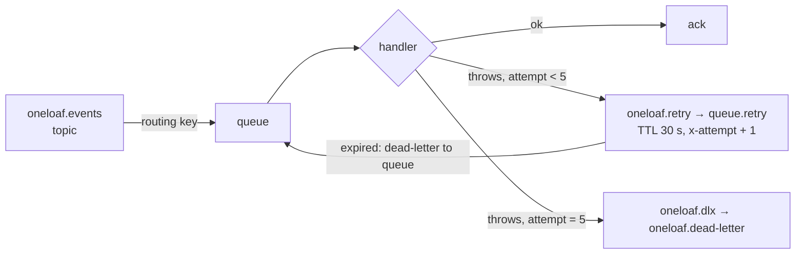

# Cross-service contracts

The services interact in two ways: the AI Assistant calls the Core API over HTTP, and the Core API and Notification
service exchange events over RabbitMQ. Both are contracts — changing them follows the [versioning policy](../guides/versioning.md).

## HTTP: Assistant → Core API

| Aspect | Contract |
|---|---|
| Base URL | `Assistant__CoreApiBaseUrl` (internal, e.g. `http://core-api:8080`) |
| Identity | the baker's bearer token, forwarded unchanged — no service account |
| Correlation | `X-Correlation-ID` and `traceparent` forwarded |
| Resilience | standard resilience handler: timeout, retries with jitter for transient errors, circuit breaker |
| Endpoints used | `GET /recipes`, `GET /recipes/{id}`, the calculator endpoints, `GET /starters`, `GET /ingredients/{id}/prices`, `GET /warnings`, `POST /batches/preview`, `POST /batches`, `GET /bake-records/{id}`, `GET …/stage-log`, `PUT …/analysis` |
| Errors | Core API problem details are passed to the model as a failed tool result (the turn continues) |

These endpoints are part of the public Core API contract ([reference](../reference/core-api.md)); the assistant has no
private endpoints.

## Events: RabbitMQ

**Exchange** `oneloaf.events` (topic, durable). Messages are persistent JSON (camelCase, snake_case enums) published with
publisher confirms after the database transaction commits.

| Routing key | Producer | Consumer queue | Body schema | Purpose |
|---|---|---|---|---|
| `batch.planned` | Core API | `notification.batch-events` | [schema](../schemas/events/batch.planned.schema.json) | "Batch planned, first reminder at …" push |
| `batch.completed` | Core API | `notification.batch-events` | [schema](../schemas/events/batch.completed.schema.json) | "Rate your bake" push |
| `starter.fed` | Core API | `notification.starter-events` | [schema](../schemas/events/starter.fed.schema.json) | "Next feeding at …" push |
| `account.deleted` | Core API | — (reserved) | [schema](../schemas/events/account.deleted.schema.json) | caches and counters of the user can be dropped |
| `reminder.due` | Notification scheduler | `notification.reminders` | [schema](../schemas/events/reminder.due.schema.json) | deliver a due reminder |

Example body of `batch.planned`:

```json
{
  "batchId": "6f1d0c9e-4c84-4f0a-9d7e-2b1f3c4d5e6f",
  "ownerId": "30663e7c-130f-4af7-a846-4dbf85602e4f",
  "name": "Weekend bake",
  "plannedStartAt": "2026-12-05T06:00:00+00:00",
  "plannedReadyFrom": "2026-12-05T21:05:00+00:00",
  "plannedReadyTo": "2026-12-06T00:20:00+00:00",
  "firstReminderAt": "2026-12-05T05:00:00+00:00",
  "occurredAt": "2026-11-23T04:08:39+00:00"
}
```

### Envelope (AMQP properties and headers)

| Property / header | Value |
|---|---|
| `message_id` | UUID, stable across retries (deduplication key) |
| `correlation_id`, header `correlation-id` | correlation id of the request that caused the event |
| `type`, header `event-type` | routing key |
| header `occurred-at` | ISO 8601 instant |
| header `traceparent` | W3C trace context |
| header `x-attempt` | delivery attempt, 1 on first delivery |
| `content_type` | `application/json` |
| `delivery_mode` | 2 (persistent) |

### Delivery, retry and dead letters



- At-least-once delivery; consumers are idempotent (reminders check their database status first).
- `RabbitMq__MaxAttempts` (5) and `RabbitMq__RetryDelaySeconds` (30) configure the policy; every service declares the
  topology it consumes idempotently at start.
- A message in `oneloaf.dead-letter` triggers the `DeadLetterQueueNotEmpty` alert; inspect it in the RabbitMQ UI.
- Publishing is best effort: if the broker is down the request still succeeds (logged), because the database stays the
  source of truth — reminders are polled from the `reminders` table, not taken from events.

## Shared database objects

Core API procedures create `reminders` rows that the Notification service delivers; the columns `status`, `sent_at` and
`attempts` are the only ones the Notification service writes. JWTs are the third shared contract: issued by the Core
API, validated by all ([authentication](../guides/authentication.md)).
