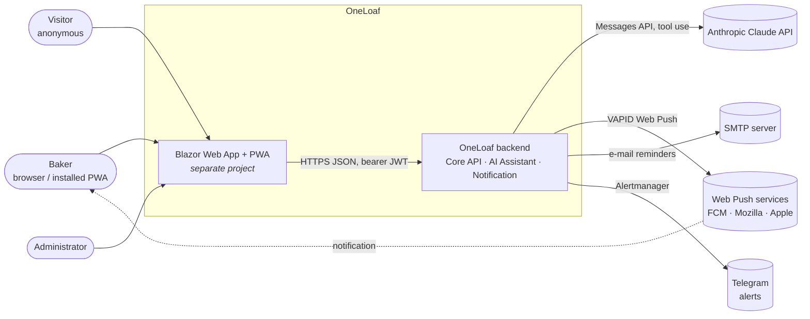
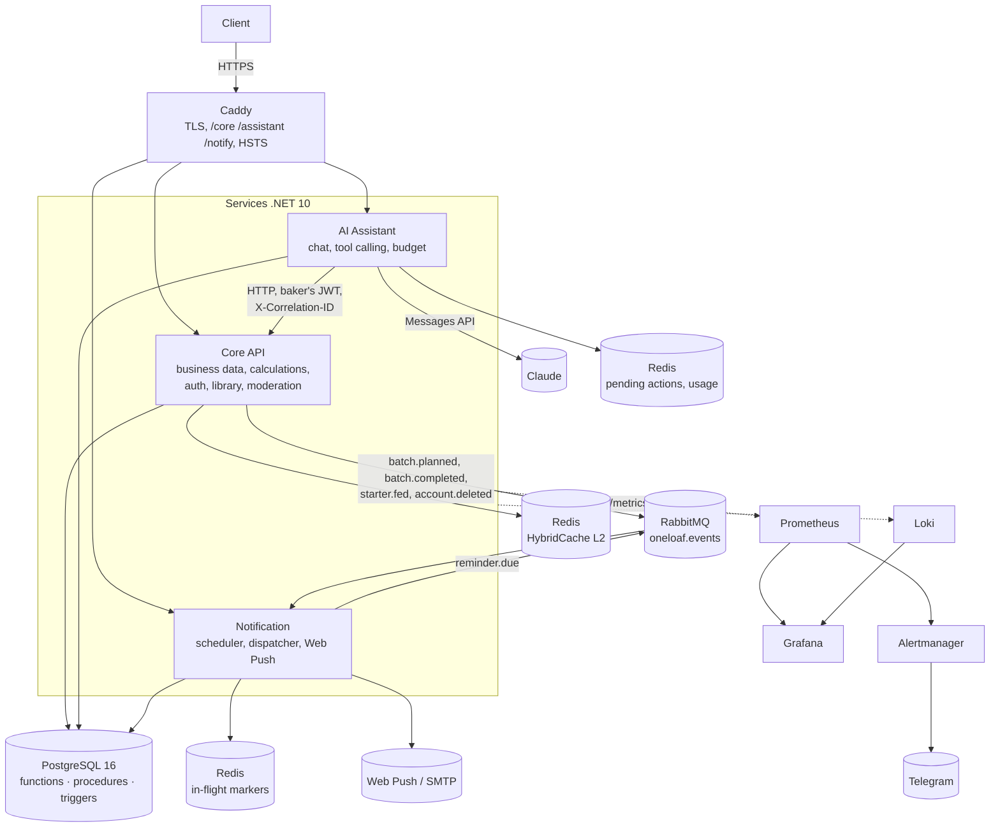
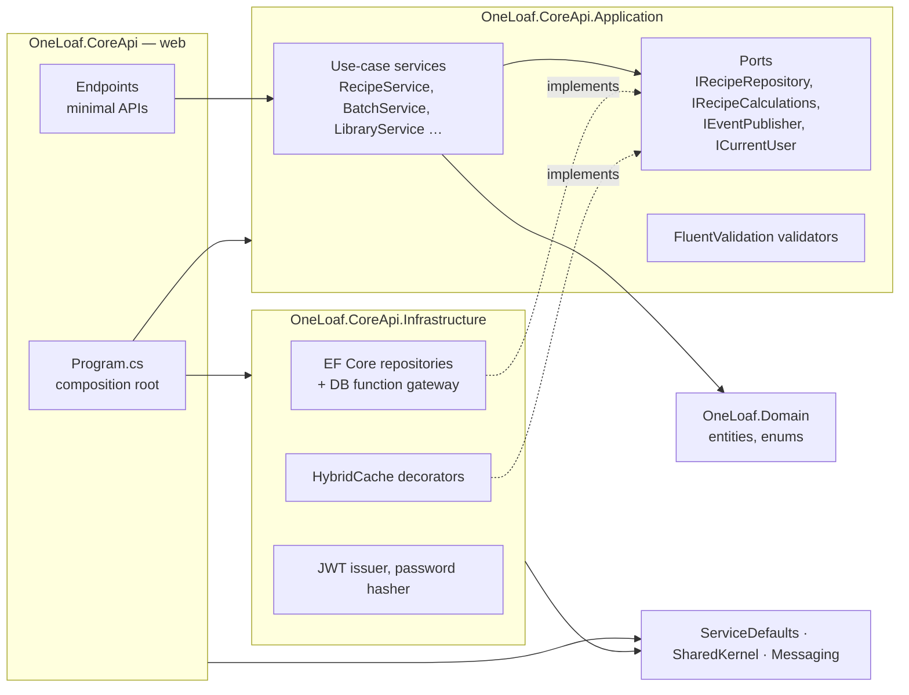
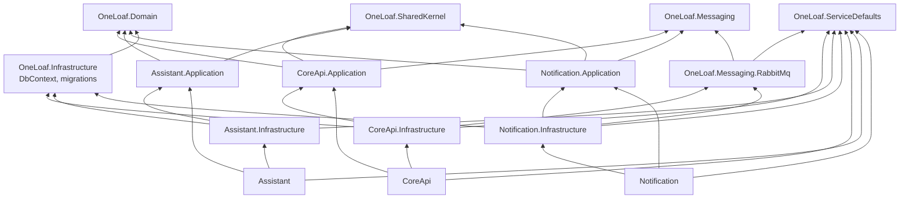
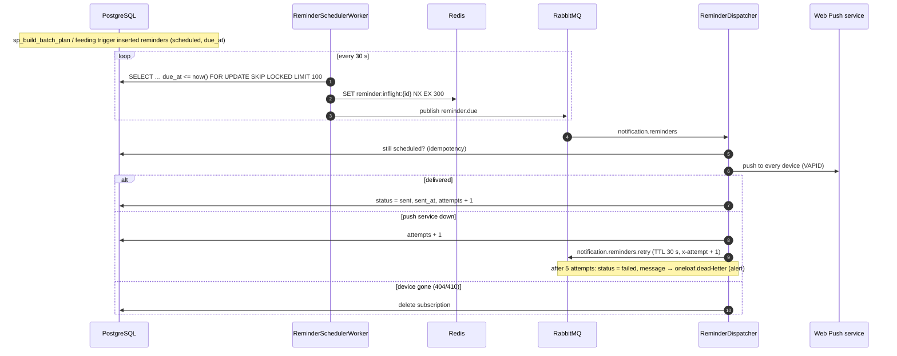
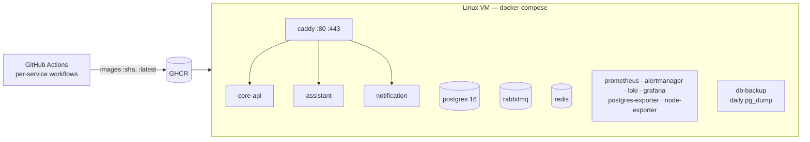

# Architecture overview

## System context



## Containers



`redis`, `redis2` and `redis3` are one Redis instance with separate key prefixes.

| Service | Owns | Talks to |
|---|---|---|
| **Core API** | users, workspace, calculations (via DB functions), batches, history, library, moderation | PostgreSQL, Redis cache, RabbitMQ (publish) |
| **AI Assistant** | conversations, messages, pending actions, usage | Core API (HTTP), Claude, PostgreSQL, Redis |
| **Notification** | push subscriptions, reminder delivery | PostgreSQL (reminders), RabbitMQ (publish + consume), Redis, Web Push, SMTP |

All three share one PostgreSQL database (schema owned by the migrator, services connect as `oneloaf_app`); each service
reads and writes only its own tables, except that reminders are created by Core API procedures and delivered by the
Notification service.

## Components inside a service



Dependency rules (`Api → Application → Domain`, `Infrastructure → Application`; Application never references EF Core,
ASP.NET Core, RabbitMQ, Redis, Anthropic, Web Push or MailKit; services never reference each other) are checked by
`tests/OneLoaf.ArchitectureTests`.

## Project dependencies



## Request lifecycle

What happens to `POST /core/api/v1/batches`:

```mermaid
sequenceDiagram
    autonumber
    participant C as Client
    participant Caddy
    participant MW as Middleware pipeline
    participant E as Endpoint + filters
    participant S as BatchService
    participant DB as PostgreSQL
    participant MQ as RabbitMQ
    C->>Caddy: POST /core/api/v1/batches (Bearer, X-Correlation-ID)
    Caddy->>MW: POST /api/v1/batches (prefix stripped, X-Forwarded-For)
    Note over MW: forwarded headers → correlation id (scope, response header)<br/>→ request logging → exception handler → authentication (JWT)<br/>→ authorization (fallback: authenticated) → rate limiter → cache invalidation
    MW->>E: route match
    E->>E: FluentValidation filter (400 on failure)
    E->>S: CreateAsync(request, ct)
    S->>DB: recipes/starters owned by sub? (404 otherwise)
    S->>DB: INSERT batch + items; CALL sp_build_batch_plan (stages, reminders, cost)
    DB-->>S: committed
    S->>MQ: publish batch.planned (confirm, correlation-id, traceparent headers)
    S-->>E: BatchDto
    E-->>C: 201 Created, Location, BatchDto, X-Correlation-ID
    Note over MW: on any exception: GlobalExceptionHandler → problem details (status by type/SQLSTATE)
```

## Reminder pipeline



The assistant planning flow (UC-01) is in the [assistant guide](../guides/assistant.md#conversation-flow-uc-01);
login is in [authentication](../guides/authentication.md#request-lifecycle).

## Deployment



Only Caddy publishes ports. Configuration is environment variables written from GitHub Environment secrets
(`deploy/docker-compose.prod.yml`). Each service has its own workflow with path filters, so a change to one service
builds, tests and ships only that service; `security.yml` scans secrets, dependencies and images.

## Observability

| Signal | How |
|---|---|
| Logs | Serilog compact JSON to stdout and Loki; properties `Service`, `CorrelationId`, `UserId`, trace ids; no PII |
| Metrics | OpenTelemetry → `/metrics` (Prometheus): HTTP, runtime, Npgsql, plus `oneloaf_reminders_*`, `oneloaf_ai_*`, `oneloaf_cache_*` |
| Traces | W3C `traceparent` across HTTP calls and RabbitMQ headers |
| Dashboards | Grafana, provisioned from `deploy/grafana` |
| Alerts | `deploy/prometheus/alerts.yml` → Alertmanager → Telegram: service down, 5xx > 5 %, p95 > 1 s, reminder failures, dead letters, AI cost, PostgreSQL down, disk |
| Health | `/health/live` (process) and `/health/ready` (dependencies) on every service |
