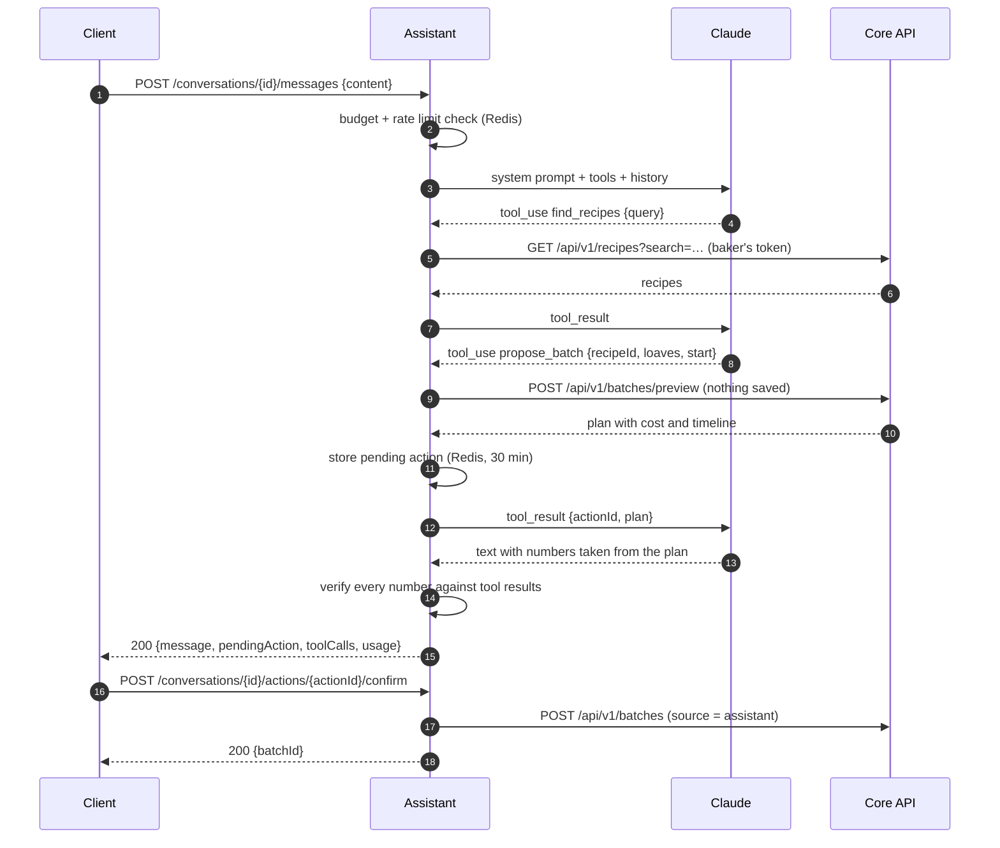

# AI Assistant

The assistant is a chat with Anthropic Claude (model from configuration, default `claude-haiku-4-5`) that answers
baking questions with the baker's own data and can prepare batches.

## Conversation flow (UC-01)

At most 6 tool rounds per message. The tools are read-only except `propose_batch`, which only *proposes*.

| Tool | Core API call |
|---|---|
| `find_recipes`, `get_recipe` | recipe list / effective recipe |
| `calculate_cost`, `calculate_timeline`, `calculate_start_window`, `calculate_production_figures` | calculator endpoints |
| `list_starters`, `get_ingredient_prices`, `get_missing_data` | starters, price history, warnings |
| `preview_batch_plan`, `propose_batch` | batch preview (+ pending action) |
| `get_bake_analysis_data` | bake record and stage log |

## Numbers come only from tools

Every number in the final answer must appear in a tool result of the same turn (or in the user's message). If the model
writes a number that no tool produced, the assistant asks it once to correct the answer; if it still does, the number
is removed and listed in `unverifiedNumbers` (normally empty). General advice that is not based on the baker's data
comes with a `disclaimer`. The first answer of a conversation says that it is an AI.

## Pending actions

`pendingAction` contains the plan exactly as the Core API computed it. Show it and offer **Confirm** / **Decline**.

| Call | Result |
|---|---|
| `POST …/actions/{actionId}/confirm` | `200 {batchId}`; the batch is created with `source: assistant` |
| `POST …/actions/{actionId}/decline` | `204`; nothing is saved |
| either, after 30 minutes or a second time | `409` |

## Bake analysis (UC-02)

`POST /api/v1/bake-records/{id}/analysis` reads the record and its stage log through the Core API, asks Claude for
probable causes, stores the text in the record and returns it. `422` when the record has no rating or comment yet,
`503` when Claude is unavailable (the record is unchanged).

## Limits and failures

| Situation | Response |
|---|---|
| more than 10 messages per minute | `429`, `Retry-After` |
| daily requests/tokens of the user or monthly budget reached | `429` with the reason in `detail` |
| Claude timeout, rate limit, 5xx or network error | `503 service-unavailable`, `Retry-After`; offer the planning form |
| tool call fails (e.g. recipe not found) | the model gets the error as a tool result and explains it |

`GET /api/v1/usage/me` shows today's usage. Conversations and messages (including tool calls, `?includeTools=true`)
are stored for audit and can be deleted with the conversation.

## Privacy

Only the baker's own data reaches the model, through tools that run with the baker's token. Message contents are never
written to logs; logs carry ids, token counts and the correlation id.
