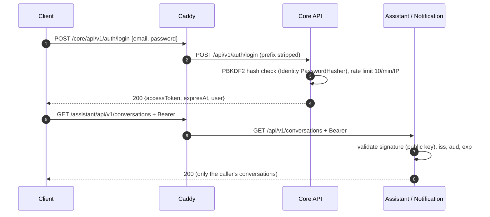

# Authentication and authorization

## Summary

| Topic | Rule |
|---|---|
| Scheme | `Authorization: Bearer <JWT>` on every non-anonymous endpoint of all three services |
| Issuer | Core API, `POST /api/v1/auth/login` |
| Algorithm | RS256 (RSA 2048); private key only in the Core API, public key in every service |
| Lifetime | 60 minutes (`Jwt__AccessTokenMinutes`), clock skew tolerance 30 s |
| Refresh | `POST /api/v1/auth/refresh` with the refresh token cookie; rotating, 30 days (`Jwt__RefreshTokenDays`) |
| Roles | `user` (default), `admin` (moderation endpoints) |
| Anonymous endpoints | register, login, library browsing (`GET /library…`), VAPID public key, health |

## Token contents

| Claim | Meaning |
|---|---|
| `sub` | User id (UUID) — the only identity the services trust |
| `email`, `name` | For display; never used for authorization |
| `role` | `user` or `admin` |
| `iss`, `aud` | `Jwt__Issuer` (e.g. `https://<domain>/core`) and `Jwt__Audience` (`oneloaf`) — both validated |
| `exp`, `nbf`, `iat`, `jti` | Validity window and token id |

## Request lifecycle

## Per-user isolation

Every query of workspace data filters by `sub` from the token, never by an id from the body. Asking for another user's
object returns **`404 Not Found`**, not `403`, so the existence of other users' data is not disclosed. The database adds
a second net: triggers reject rows that link objects of different owners.

| Status | Meaning |
|---|---|
| `401` | No token, bad signature, wrong issuer/audience, or expired — log in again |
| `403` | Valid token but the role is not enough (a non-admin calling `/admin/…`) |
| `404` | The object does not exist **or** belongs to someone else |

## Service-to-service calls

The assistant's tools call the Core API **with the caller's own bearer token** (forwarded unchanged, plus the
`X-Correlation-ID`). There is no service account with wider rights, so the model can only read and change what the
baker could. Proposals that change data (a new batch) are saved only after the baker confirms them in the client.

Event messages over RabbitMQ carry the owner id in the body; consumers trust the broker (internal network, credentials
per environment), not the client.

## Session refresh

A sign-in returns the access token in the body and sets a **refresh token** as a cookie of the Core API:
`oneloaf_refresh`, `HttpOnly` (scripts cannot read it), `SameSite=Strict`, `Secure` over HTTPS, limited to the auth
endpoints by its path (`Jwt__RefreshCookiePath`). The token never appears in a response body.

| Call | Result |
|---|---|
| `POST /api/v1/auth/refresh` (cookie sent by the browser) | `200 {accessToken, expiresAt, user}` and the next refresh cookie |
| the same with a missing, expired or revoked token | `401`; the cookie is removed |
| the same with a token that was already exchanged | `401`, and **every token of that sign-in is revoked** |

- **Rotation.** Every exchange replaces the refresh token; the old one is marked as used.
- **Reuse detection.** A used token that shows up again means it was copied. The whole family (all tokens of that
  sign-in) is revoked, so neither side can continue without the password.
- **Storage.** The database keeps only the SHA-256 hash of a token (`refresh_tokens`), with the family, the expiry and
  the rotation and revocation times. Tokens are deleted with the account and when a user is anonymized.
- **Lifetime.** 30 days from the last exchange (`Jwt__RefreshTokenDays`): a baker who opens the app at least once a
  month stays signed in.
- A browser on another origin (development) must send the request with credentials; CORS allows credentials only for
  the origins of `Cors__AllowedOrigins`.

## Logout

`POST /api/v1/auth/logout` returns `204`, revokes the refresh tokens of this sign-in and removes the cookie. The access
token is stateless: the client drops it; it stays technically valid until `exp` (max. 60 minutes). Deleting the account
(`DELETE /api/v1/me` with the password) removes all data and sessions at once.

## Keys and rotation

Keys come from the environment (`Jwt__SigningKeyPem`, `Jwt__PublicKeyPem`), never from the repository. To rotate:
deploy the new public key to all services together with the new private key to the Core API; tokens signed with the old
key fail after the deployment and users log in again (at most one token lifetime of inconvenience).

## Browser clients

- Keep the access token in memory (or `sessionStorage`), not in `localStorage` shared with third-party scripts.
- Never handle the refresh token in script: let the browser keep the cookie and call `auth/refresh` before the access
  token ends.
- CORS is limited to `Cors__AllowedOrigins`.
- HTTPS only in production (Caddy, HSTS).
