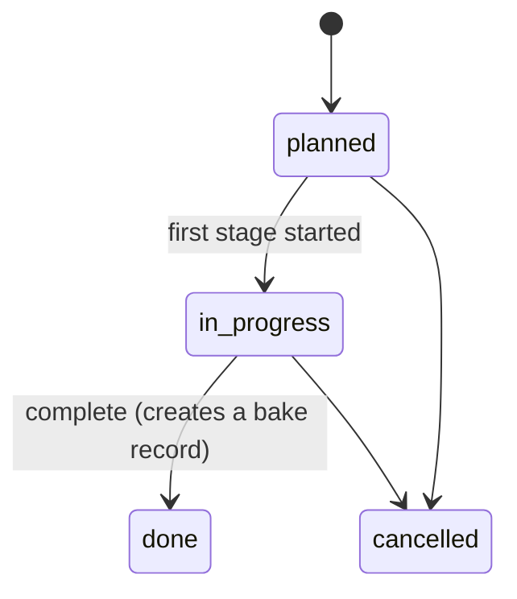

# Concepts

The model behind the API, in the order a baker meets it.

## Workspace and isolation

Everything a user creates — flours, ingredients and their prices, recipes, starters, batches, history, conversations —
is their private **workspace**. Only the shared **library** is public. See [authentication](authentication.md#per-user-isolation).

## Kitchen settings

One row per user: oven power and capacity, mixer bowl capacity, electricity tariff, packaging cost per loaf, loss rate,
labour rate, currency and IANA time zone. They feed the cost (electricity, packaging, labour, loss lines), kneading
cycles (bowl capacity) and oven loading (capacity).

## Catalog: flours, ingredients, prices, stock

- A **flour** has a type (`wheat`, `rye`, `spelt`, …) and protein percent; recipes can be filtered by protein (US-37).
- An **ingredient** has a category (`flour`, `water`, `salt`, `starter`, `yeast`, …) and a unit (`g`, `kg`, `ml`, `l`,
  `pcs`); a flour ingredient links to a flour. Categories decide what counts as flour and liquid for hydration.
- **Prices** form a history per ingredient (`effectiveFrom`). A cost uses the price valid on its date, so the cost of a
  bake in September stays as it was even after a price change in October. A price entered by mistake can be replaced
  (`PUT …/prices/{priceId}`) or deleted; there is one price per ingredient and date.
- **Stock** is a ledger per ingredient (`GET /ingredients/{id}/stock-movements`); the stock is the sum of the
  movements, in the ingredient unit. A **record** (`POST …/records`: packs × pack size for an amount) sets the price of
  its date and adds to the stock; with `priceOnly` it sets only the price. A **correction** (`POST …/stock-adjustments`) sets the stock to the counted
  quantity. Creating a batch takes its ingredients, re-planning changes the stock by the difference, and cancelling or
  deleting a batch with `ingredientsUsed=false` returns them. A starter feeding takes flour and water from the
  ingredients named on the starter.
- A **starter is also an ingredient** (`starter.ingredientId`, category `starter`, same name): recipes use it. After a
  feeding the starter ripens until `expectedPeakAt` (`riseHours` is required); then `usableShare` (two thirds by
  default) of flour + water + kept becomes the stock of that ingredient, and the rest stays for the next feeding. The
  next feeding returns the ripe starter that is left: `suggestedKeptG` is the reserve plus what no batch used. A batch
  is checked against the stock at its planned start, so a starter fed today counts for a batch tomorrow.
- Ingredients and recipes have one **photo** each (`PUT/GET/DELETE …/photo`, multipart field `file`; `hasPhoto` in the
  DTOs). Only ingredients with `trackStock = true` are consumed and checked: the first
  purchase or correction switches it on, and `PUT /ingredients/{id}` can switch it off. `isLowStock` and the
  `low_stock` warning report a stock below `reorderLevel` (or below zero).
- A batch **preview** returns the stock check: `stock.shortages`, `stock.maxLoaves` (loaves the stock covers at full
  quantities, one-item batches) and `stock.maxScale`. Sending `ingredientScale` below 1 keeps the loaves and bakes
  from what is in stock: starter amount, kneading cycles, ingredient cost and consumption shrink with it.

## Recipes and variants

A **recipe** has a yield (loaves, loaf weight), ingredient lines and ordered **stages** (mix, autolyse, bulk
fermentation, fold, preshape, shape, proof, bake, cool) with a min–max duration, active (hands-on) time, temperature,
proof mode (`warm`/`cold`, only for `proof` stages) and oven/mixer use.

A **variant** is a child recipe that stores only its differences: replaced or removed lines and stages, added ones.
`GET /recipes/{id}` of a variant returns the *effective* recipe with `isInherited` per line; `PUT` takes the full
effective content and the server stores the diff. `GET /recipes/{id}/comparison` shows what differs from the parent.
A recipe with variants cannot be deleted (`409`) — archive it.

## Calculations

All numbers come from PostgreSQL functions called by the Core API — never from the client or the language model:

| Function | Endpoint |
|---|---|
| `fn_recipe_cost` | `GET /recipes/{id}/cost` — ingredient, electricity, packaging, labour, loss and total lines |
| `fn_recipe_timeline`, `fn_recipe_ready_window` | `GET /recipes/{id}/timeline` |
| `fn_recipe_start_window` | `GET /recipes/{id}/start-window` |
| `fn_dough_weight_g`, `fn_kneading_cycles`, `fn_starter_amount_g` | `GET /recipes/{id}/production-figures` |
| `sp_build_batch_plan`, `sp_extend_batch_stage` | batch create / preview / extend |
| `sp_publish_recipe` | `POST /recipes/{id}/publish` |

A result is **incomplete** when an input is missing (a price, the oven power); the response says which instead of
guessing. Results are cached per user for 10 minutes and dropped on any change of that user's data.

## Starters

A **starter** has hydration, feeding mode (`regular`, `weekly`, `fridge`) and interval. Recording a **feeding**
recomputes the next feeding and expected peak, and reschedules the feeding reminder (database trigger).

## Batches and stages

A **batch** bakes one or more recipes (items, with loaves and an optional starter) from a planned start. Creating it
runs `sp_build_batch_plan`: every stage gets a planned window, the starter amount and kneading cycles are computed, the
cost is frozen at the price date, and **reminders** are scheduled.

Stage states: `pending → running → done`, or `pending → skipped`. A pending stage can get new durations
(`PATCH`) or have them reset to the recipe's; pending and running stages can be extended. Later stages move with them.

## History

Completing a batch creates a **bake record**: loaves, cost, and the **stage log** with planned vs actual times and
deviations. The baker rates it (1–5), comments and attaches crumb photos (US-51); the assistant can analyse it (US-36).
A batch that went differently from the recipe can be saved as a new **variant** with the real durations (US-25). Statistics aggregate ratings
and deviations per recipe. Everything exports to CSV.

## Reminders and notifications

Reminders (`starter_feeding`, `before_kneading`, `stage_start`) are rows in the database, created by procedures and
triggers. The Notification service polls them, publishes `reminder.due` to RabbitMQ and delivers by Web Push (or
e-mail) — see [architecture](../architecture/overview.md#reminder-pipeline).

## Library

**Publishing** stores an immutable JSON **snapshot** of the effective recipe; later edits of the recipe do not change
it. Anyone can browse published recipes; users comment, react (`like`, `love`, `want_to_bake`), **copy** a recipe into
their workspace (ingredients matched by name or created) and **report** content. Administrators resolve reports by
removing the content or rejecting the report; a removed publication cannot be published again.

## Assistant

A chat with Claude that uses tools over the user's own data and never invents numbers. See the [assistant guide](assistant.md).
