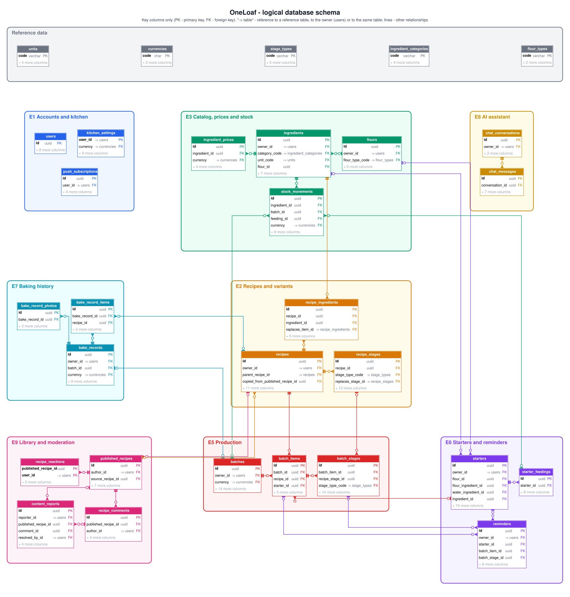
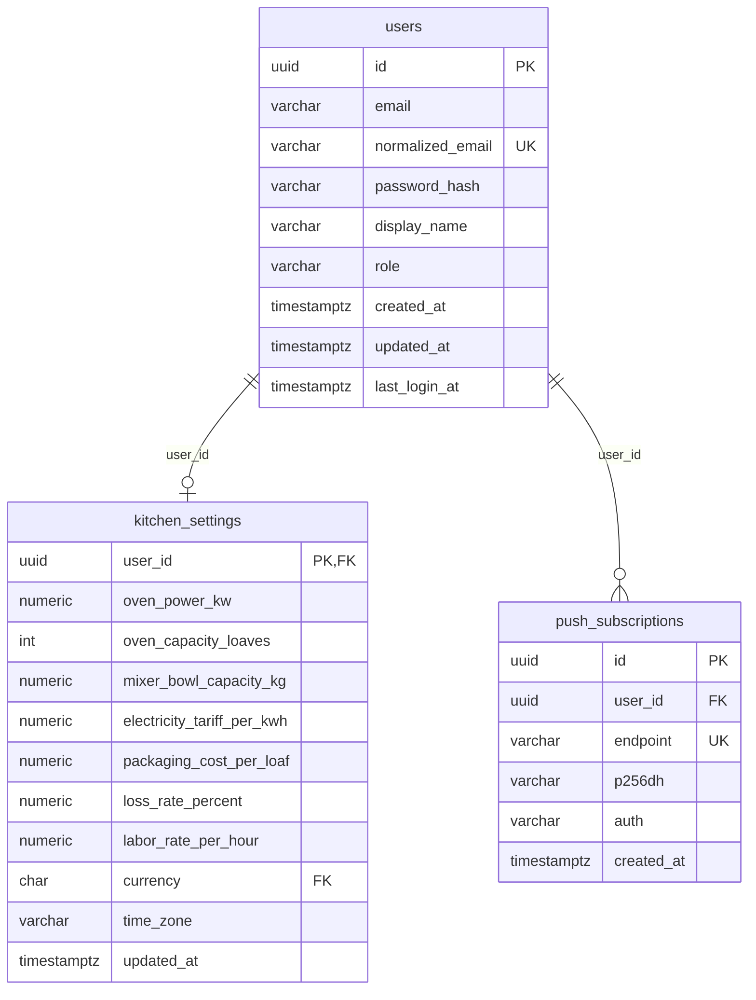
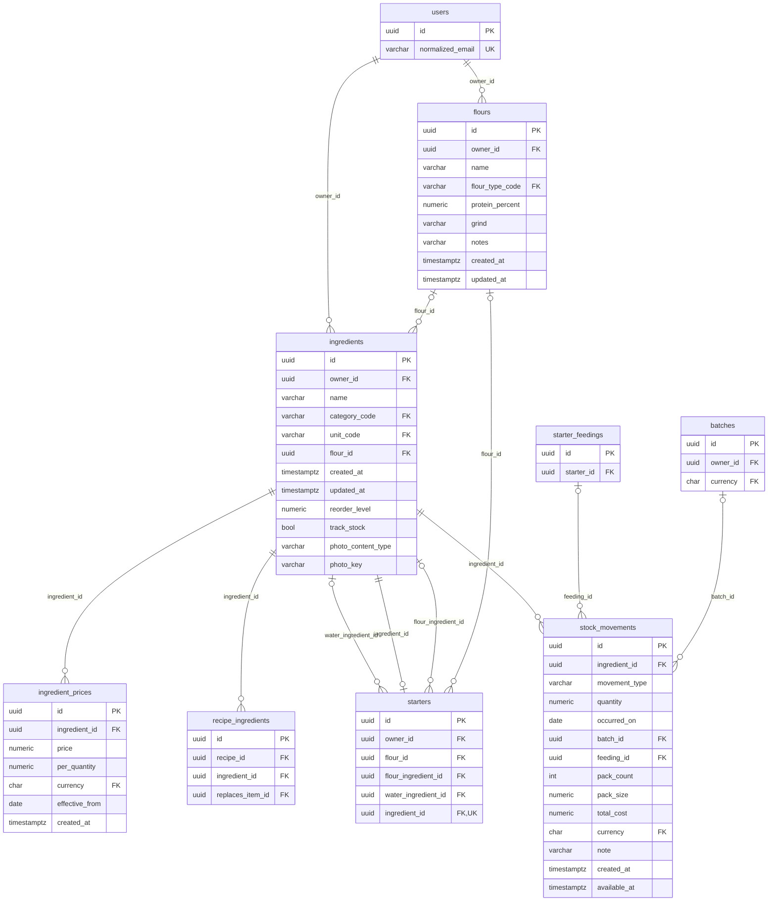
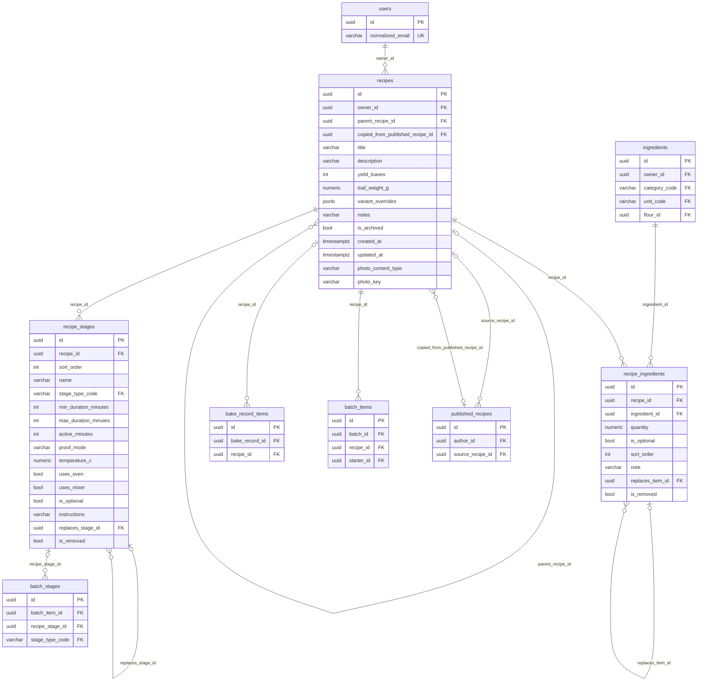
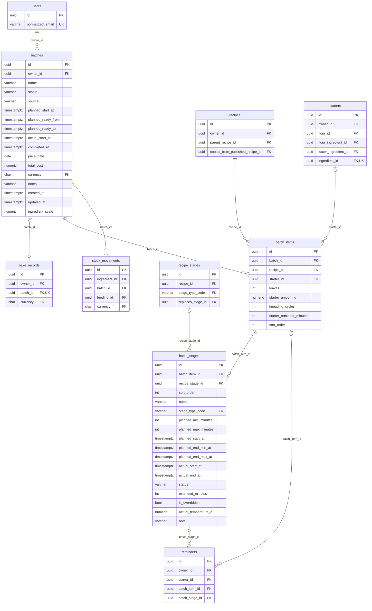
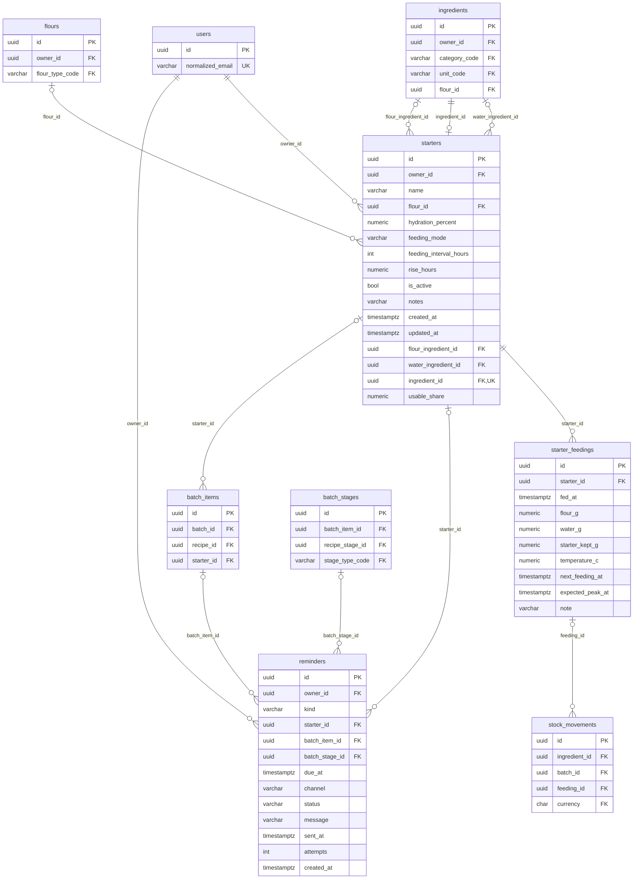
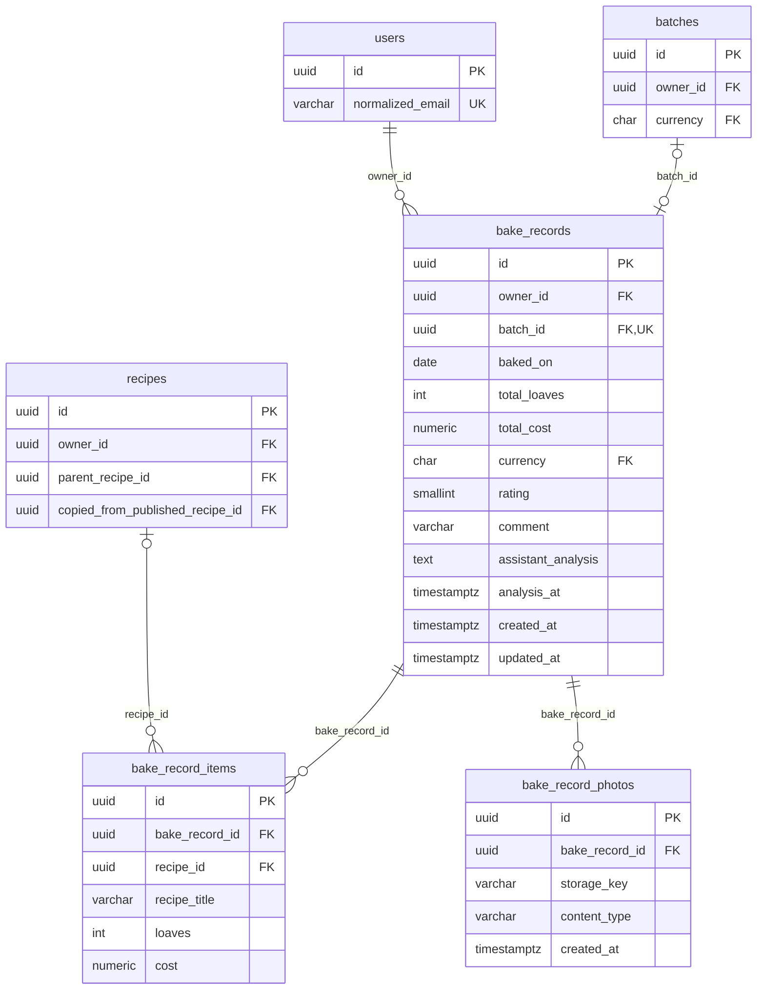
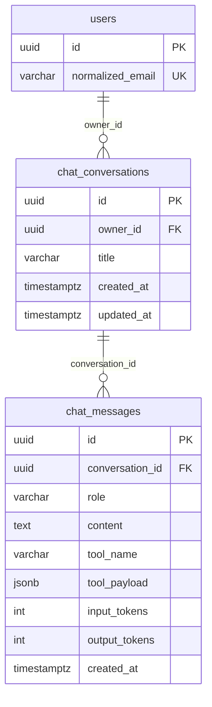
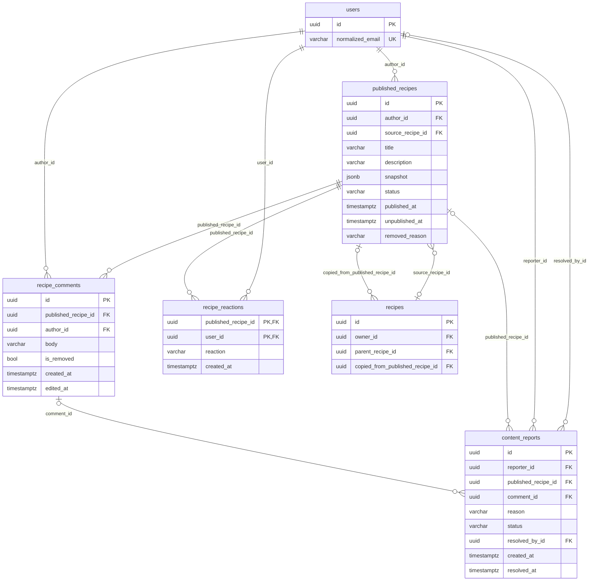

# OneLoaf logical database schema

> Generated by `tools/generate_logical_schema.py` from the PostgreSQL schema created by the migrations. Columns, types and constraints of every table are in the [data dictionary](data-dictionary.md).

## Overview

The overview shows every table with its key columns; all columns are in the per-block diagrams below and in the data dictionary. The frame colour shows the functional block. Lines are relationships between tables of the domain. References to reference tables, to the owner and to the same table (recipe variants) are shown in the column row as "-> table" to keep the diagram readable: every workspace table references `users` (`owner_id`, `ON DELETE CASCADE`). Line ends: "||" - exactly one, "o|" - zero or one, "o<" - zero or many. Source of the diagram: [`logical-schema.dot`](logical-schema.dot).

## Blocks

| Block | Tables | Purpose |
|---|---|---|
| Reference data | `units`, `currencies`, `stage_types`, `ingredient_categories`, `flour_types` | Fixed data: units, currencies, stage types, ingredient categories, flour types. Inserted by a migration; the services only read them. |
| E1 Accounts and kitchen | `users`, `kitchen_settings`, `push_subscriptions` | The user is the root of a workspace. All data of a baker references the user through owner_id and is deleted with the account. |
| E3 Catalog, prices and stock | `flours`, `ingredients`, `ingredient_prices`, `stock_movements` | Flours, ingredients and price history - the basis of the cost on any date - and the stock ledger of purchases and consumption. |
| E2 Recipes and variants | `recipes`, `recipe_ingredients`, `recipe_stages` | Recipe knowledge base. A variant references its parent and stores only the differences: replacing lines and variant_overrides. |
| E5 Production | `batches`, `batch_items`, `batch_stages` | Batch - items (recipe x loaves) - stage log with plan and actual times. |
| E6 Starters and reminders | `starters`, `starter_feedings`, `reminders` | Starters, feeding log and the reminder queue of the Notification service. |
| E7 Baking history | `bake_records`, `bake_record_items`, `bake_record_photos` | A record is created by a trigger when a batch is finished and keeps a snapshot on the bake date. |
| E8 AI assistant | `chat_conversations`, `chat_messages` | Conversations and the log of backend tool calls. |
| E9 Library and moderation | `published_recipes`, `recipe_comments`, `recipe_reactions`, `content_reports` | Immutable snapshots of published recipes, comments, reactions, reports. |

## Relationship types

| Type | Where in the schema |
|---|---|
| 1 : 1 | `users` - `kitchen_settings` (PK = FK); `batches` - `bake_records` (unique `batch_id`) |
| 1 : N | `users` - every workspace table; `recipes` - `recipe_ingredients`, `recipe_stages`; `batches` - `batch_items` - `batch_stages`; `starters` - `starter_feedings`; `chat_conversations` - `chat_messages` |
| M : N | `recipes` and `ingredients` through `recipe_ingredients`; `users` and `published_recipes` through `recipe_reactions` (composite PK) and through `recipe_comments` |
| Recursive (hierarchy) | `recipes.parent_recipe_id` references `recipes` (variants of any level); `recipe_ingredients.replaces_item_id`, `recipe_stages.replaces_stage_id` (a line of a variant replaces a line of the parent) |
| Reference (N : 1 to a reference table) | `ingredients` to `units` and `ingredient_categories`; `flours` to `flour_types`; `recipe_stages`, `batch_stages` to `stage_types`; prices and amounts to `currencies` |
| Optional (0..1) | `ingredients.flour_id`, `batch_items.starter_id`, `bake_records.batch_id`, `published_recipes.source_recipe_id`, targets of `reminders` and `content_reports` |

## Blocks in detail

Mermaid ER notation: `||` - exactly one, `|o` - zero or one, `o{` - zero or many. The label of a line is the foreign key column.

### E1 Accounts and kitchen

The user is the root of a workspace. All data of a baker references the user through owner_id and is deleted with the account.

### E3 Catalog, prices and stock

Flours, ingredients and price history - the basis of the cost on any date - and the stock ledger of purchases and consumption.

### E2 Recipes and variants

Recipe knowledge base. A variant references its parent and stores only the differences: replacing lines and variant_overrides.

### E5 Production

Batch - items (recipe x loaves) - stage log with plan and actual times.

### E6 Starters and reminders

Starters, feeding log and the reminder queue of the Notification service.

### E7 Baking history

A record is created by a trigger when a batch is finished and keeps a snapshot on the bake date.

### E8 AI assistant

Conversations and the log of backend tool calls.

### E9 Library and moderation

Immutable snapshots of published recipes, comments, reactions, reports.

