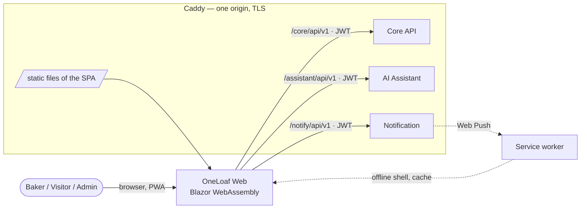
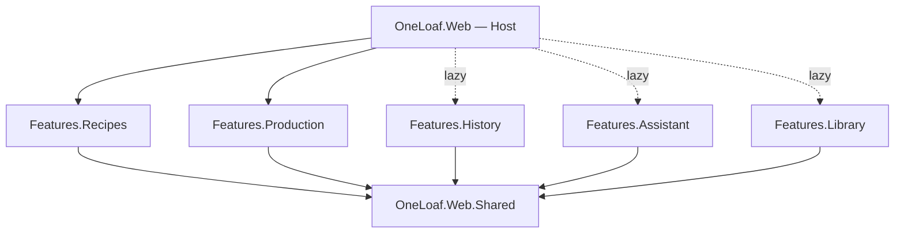
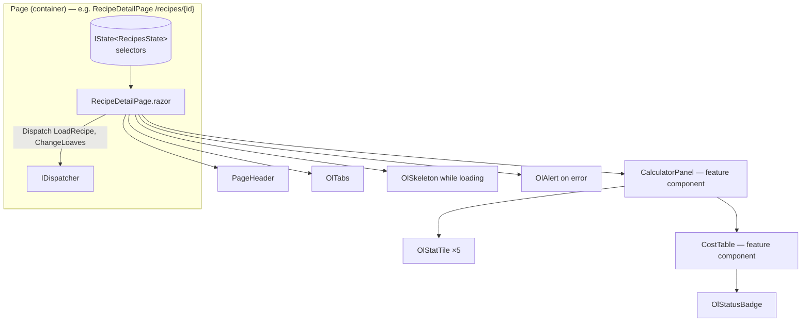
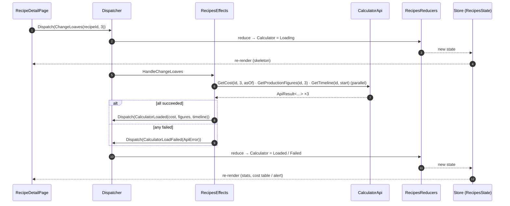
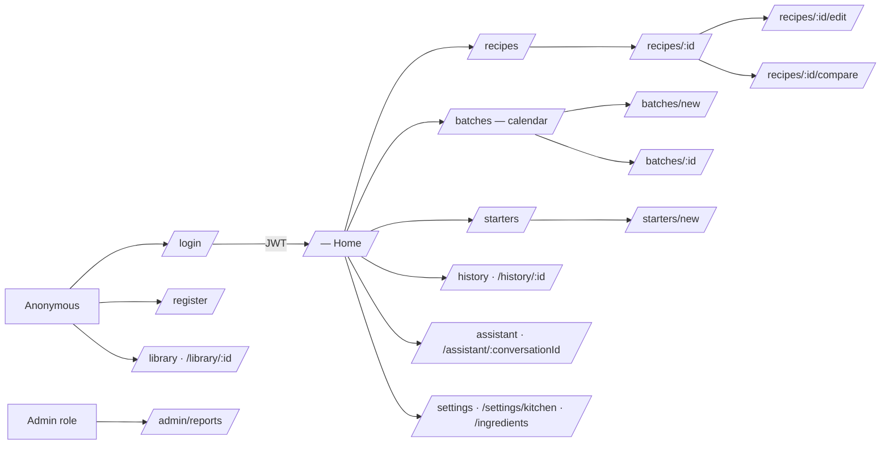
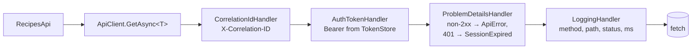

# Frontend architecture

## 0. Approach in one paragraph

OneLoaf Web is a **Blazor WebAssembly single-page application** (standalone, served as static files, installable as a
PWA). The UI is **component-based**: dumb, reusable design-system components (`Ol*`) at the bottom, feature components
above them, and routable **pages** (containers) on top that connect components to state. Shared, cross-page data follows
the **Flux / Redux pattern** through **Fluxor**: pages dispatch actions, **effects** call typed API services, pure
**reducers** produce new immutable state, components re-render from **selectors**. The code is split into **feature
modules** (one Razor class library per business area) in a **feature-sliced** layout `Host → Features → Shared`, where a
layer may depend only on layers below it; rarely used features are **lazy-loaded** assemblies. All HTTP traffic goes
through one **request pipeline** of `DelegatingHandler`s (correlation id, bearer token, ProblemDetails → typed error,
logging). Business numbers are never computed in the browser: they come from the Core API.

## 1. Context



In production the SPA, the three APIs and Grafana sit behind **one origin** (Caddy), so there is no CORS in production.
In development the SPA runs on `http://localhost:5090` and calls the services on `:5080/:5081/:5082` (CORS for that
origin only).

## 2. Solution layout

```text
src/Web/
├── OneLoaf.Web/                         ← HOST (Blazor WebAssembly app, the only executable)
│   ├── Program.cs                       DI, Fluxor, HttpClients, features, logging
│   ├── App.razor                        Router + lazy loading + AuthorizeRouteView + ErrorBoundary
│   ├── Layout/                          MainLayout, AuthLayout, AppShell (BottomBar / Rail / Sidebar), PageHeader
│   ├── Pages/                           Home, Login, Register, Settings, NotFound, Offline
│   ├── Account/                         AccountApi, SessionEffects (login, logout, delete account)
│   └── wwwroot/
│       ├── index.html                   viewport meta, theme bootstrap script, service worker registration
│       ├── manifest.webmanifest, service-worker.js, service-worker.published.js, icons/
│       ├── css/tokens.css, css/components.css, css/app.css   ← design system (copied from docs/frontend/design-system)
│       ├── js/device.js                 matchMedia / visualViewport / theme interop (ES module)
│       └── appsettings.json, appsettings.Development.json    API base URLs only (no secrets)
├── OneLoaf.Web.Shared/                  ← SHARED layer (Razor class library)
│   ├── Api/                             ApiClient, ApiResult<T>, ApiError, handlers, ServiceEndpoints options
│   ├── Contracts/Core|Assistant|Notification/   request/response records (one file per resource)
│   ├── Auth/                            TokenStore, JwtAuthenticationStateProvider, SessionState slice
│   ├── State/                           global slices: Display, Notifications (toasts), Connectivity
│   ├── Device/                          DeviceContext (size class, orientation, pointer, motion, segments)
│   ├── Ui/                              design-system components: OlButton, OlTextField, OlSelect, OlCard, …
│   ├── Forms/                           OlForm, validation attributes, ServerValidator (ProblemDetails → field errors)
│   └── Formatting/                      Quantity, Money, Duration, TimeWindow, DateTime (culture-aware)
├── OneLoaf.Web.Features.Recipes/        ← FEATURE: recipes, editor, variants, calculator, ingredients, prices, kitchen, flours
├── OneLoaf.Web.Features.Production/     ← FEATURE: batches, new batch, batch execution, calendar, starters, feedings
├── OneLoaf.Web.Features.History/        ← FEATURE (lazy): bake records, rating, stage log, statistics, photos, analysis
├── OneLoaf.Web.Features.Assistant/      ← FEATURE (lazy): conversations, chat, plan card, confirm/decline, usage
└── OneLoaf.Web.Features.Library/        ← FEATURE (lazy): public catalog, detail, comments, reactions, copy, publish, moderation
tests/
├── OneLoaf.Web.UnitTests/               bUnit + xUnit v3: components, reducers, effects, handlers, contract tests
└── OneLoaf.Web.E2ETests/                Playwright for .NET: user journeys against the published app
```

Every feature library has the same inner structure:

```text
OneLoaf.Web.Features.Recipes/
├── Pages/          routable containers (@page), one folder per screen when it has sub-components
├── Components/     feature components (RecipeCard, CostTable, StageEditorRow, VariantDiffRow, …)
├── State/          Fluxor: RecipesState, Actions, Reducers, Effects, Selectors
├── Services/       RecipesApi, IngredientsApi, CalculatorApi, KitchenApi (typed, over ApiClient)
├── Models/         form models (RecipeForm, IngredientPriceForm) + view models + mapping from contracts
├── _Imports.razor
└── RecipesFeature.cs   public static IServiceCollection AddRecipesFeature(this IServiceCollection s)
```

### Dependency rules (checked by `tests/OneLoaf.Web.UnitTests/ArchitectureTests.cs`, ArchUnitNET)



1. A feature never references another feature. Cross-feature navigation uses **routes** (`/recipes/{id}`), cross-feature
   data uses **contracts in Shared** or a **global action** in Shared (e.g. `BatchCreated` raised by the assistant and
   handled by Production).
2. `Shared` references no feature and no host.
3. `Ui` components do not inject API services or `IState<>` (dumb components) — checked by the test.
4. Pages are the only classes with `@page`; only `Services` classes use `ApiClient`.

## 3. Component model



| Kind | Knows about | Example |
|---|---|---|
| **Design-system component** (`Shared/Ui`) | Only its parameters and `EventCallback`s; renders `ol-*` classes; owns its ARIA | `OlButton`, `OlTextField`, `OlStageItem`, `OlSkeleton`, `OlDialog` |
| **Layout component** | Navigation, device class, session | `MainLayout`, `AppShell`, `BottomBar`, `NavRail`, `Sidebar`, `PageHeader`, `TwoPane` |
| **Feature component** | Feature view models; may dispatch feature actions through a callback from the page | `CostTable`, `StageEditorRow`, `PlanCard`, `FeedingForm` |
| **Page (container)** | Route parameters, `IState<>`, `IDispatcher`, `NavigationManager` | `RecipesPage`, `BatchPage`, `AssistantPage` |

## 4. State management

### Local vs global

| Kind | Where | Examples |
|---|---|---|
| **Local** (component) | fields in the component, `EditContext` | form inputs before submit, an open/closed menu, the selected tab, chat input text |
| **Feature global** (Fluxor slice per feature) | `Features.*/State` | recipe list + filters, current recipe + calculator result, current batch, starters, history filters, conversation |
| **App global** (Fluxor slices in Shared) | `Shared/State`, `Shared/Auth` | `Session` (user, token expiry, role), `Display` (theme, scale, motion, size class), `Notifications` (toasts), `Connectivity` (online/offline) |

Rule of thumb: state goes global when two components that are not parent/child need it, when it must survive navigation
(the recipes filter when returning from a recipe), or when an async chain spans several pages.

### Flux flow



### Slices

| Slice | State (records) | Main actions | Effects call |
|---|---|---|---|
| `Session` | `User?`, `ExpiresAt`, `Role`, `Status` | `Login`, `LoggedIn`, `Logout`, `SessionExpired` | `AccountApi` |
| `Display` | `Theme`, `Scale`, `ReduceMotion`, `SizeClass`, `Orientation`, `IsOnline` | `SetTheme`, `SetScale`, `DeviceChanged` | `device.js`, `localStorage` |
| `Notifications` | `ImmutableList<Toast>` | `ShowToast`, `DismissToast` | timer |
| `Recipes` | list (`Loadable<Page<RecipeSummary>>`), filter, current recipe, calculator, comparison | `LoadRecipes`, `SetRecipeFilter`, `LoadRecipe`, `ChangeLoaves`, `ChangeAsOf`, `SaveRecipe`, `CreateVariant` | `RecipesApi`, `CalculatorApi` |
| `Catalog` | ingredients, selected ingredient + price history, flours, kitchen settings, reference data (cached) | `LoadIngredients`, `AddPrice`, `SaveKitchen` | `IngredientsApi`, `KitchenApi`, `ReferenceApi` |
| `Production` | batches (week), current batch, preview, kneading plan | `LoadWeek`, `PreviewBatch` (debounced), `CreateBatch`, `StartStage`, `CompleteStage`, `ExtendStage`, `ResetStage` | `BatchesApi` |
| `Starters` | starters, feedings of selected | `LoadStarters`, `LogFeeding`, `SaveStarter` | `StartersApi` |
| `History` (lazy) | records, filter, statistics, selected record + stage log | `LoadHistory`, `RateBake`, `RequestAnalysis` | `BakeRecordsApi`, `InsightsApi` |
| `Assistant` (lazy) | conversations, messages, pending action, sending, usage | `SendMessage`, `ConfirmAction`, `DeclineAction` | `ConversationsApi` |
| `Library` (lazy) | catalog page, search, detail, comments, reports (admin) | `SearchLibrary`, `AddComment`, `React`, `CopyToMine`, `Publish`, `Report` | `LibraryApi`, `ModerationApi` |

Conventions:

- `Loadable<T>` = `NotAsked | Loading | Loaded(T) | Failed(ApiError)` (a small discriminated record hierarchy in Shared)
  — every view renders all four cases; this is how "loading states for all async operations" is enforced by types.
- Selectors are static functions over state (`RecipesSelectors.VisibleRecipes(state)`) returning derived records;
  expensive projections are memoized by input reference (`Selector.Memoize`, a 20-line helper in Shared).
- Cross-feature chain example: `Assistant.ConfirmAction` → effect calls confirm → dispatches **`BatchCreated(batchId)`**
  (Shared action) → Production reducer invalidates the week, Home reloads the active batch, `Notifications` shows
  "Batch saved", and the page offers *Open batch*.

### Lazy-loaded features and Fluxor

Fluxor discovers features by assembly scanning at start-up, but a lazy assembly is not loaded yet. Lazy features
therefore register their slice **when they are loaded**: `App.razor` `OnNavigateAsync` → `LazyAssemblyLoader` → the
assembly's `IFeatureModule.Register(IStore store, IServiceProvider sp)` calls `store.AddFeature(…)` / `store.AddEffect(…)`
for its hand-declared `Feature<TState>` class and effects. A lazy feature whose state is used only by its own pages
may instead keep that state in a scoped page service (ADR-F04).

## 5. Routing

Routes, guards and lazy loading are listed in full in `screens-and-routes.md`. Summary:



- `App.razor`: `<Router AppAssembly=… AdditionalAssemblies=@_lazyLoaded OnNavigateAsync=…>` with `AuthorizeRouteView`
  (`RedirectToLogin` for anonymous users, `Forbidden` for missing role) and `<Navigating>` showing a top progress bar.
- Pages use `[Authorize]` by default (an `_Imports.razor` attribute in each feature); anonymous pages use
  `[AllowAnonymous]` (`/login`, `/register`, `/library`, `/library/{id}`).
- Query-string state for shareable views: `/recipes?search=rye&archived=true`, `/history?recipeId=…&minRating=4`,
  `/batches?week=2026-W48` (`[SupplyParameterFromQuery]`).

## 6. Request pipeline



Three named `HttpClient`s (`core`, `assistant`, `notification`) share the handler chain and differ only in base address
(`ServiceEndpoints` options from `wwwroot/appsettings*.json`). `ApiClient` returns `ApiResult<T>`; it never throws for an
HTTP error. Details: `api-client.md`.

## 7. Cross-cutting

| Concern | Implementation |
|---|---|
| Authentication | `JwtAuthenticationStateProvider` reads claims from the token in `TokenStore` (memory + `sessionStorage`), checks `exp`; a timer dispatches `SessionExpired` 1 min before expiry ("Session ends soon — sign in again") — there is no refresh token by design |
| Errors | handler pipeline → `ApiError`; `ErrorBoundary` in `MainLayout` with "Something went wrong — reload" and the correlation id; `Notifications` toasts |
| Logging | `ILogger<T>`; `builder.Logging.SetMinimumLevel(Information)` in Release, `Debug` in Development; never logs tokens or bodies |
| Device / adaptive | `DeviceContext` (Shared/Device) + `device.js` → `Display` slice; CSS does the layout, C# only switches the navigation component and pane count |
| PWA / offline | service worker caches the app shell and `GET` responses of recipes the user opened (stale-while-revalidate); `Connectivity` slice shows the offline banner and disables writes |
| Localization of numbers | `CultureInfo` from the browser for number/date formatting; units and currency from the API (`currency`, `unit`) |
| Performance | lazy assemblies, `<Virtualize>` for long lists, `ShouldRender` overrides only where measured, trimming on |
