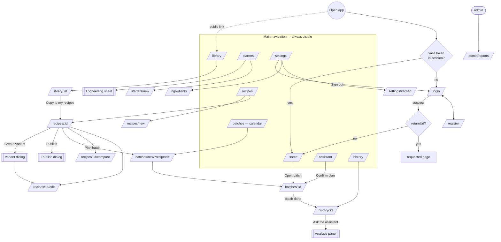
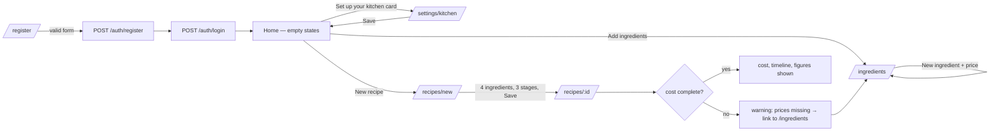
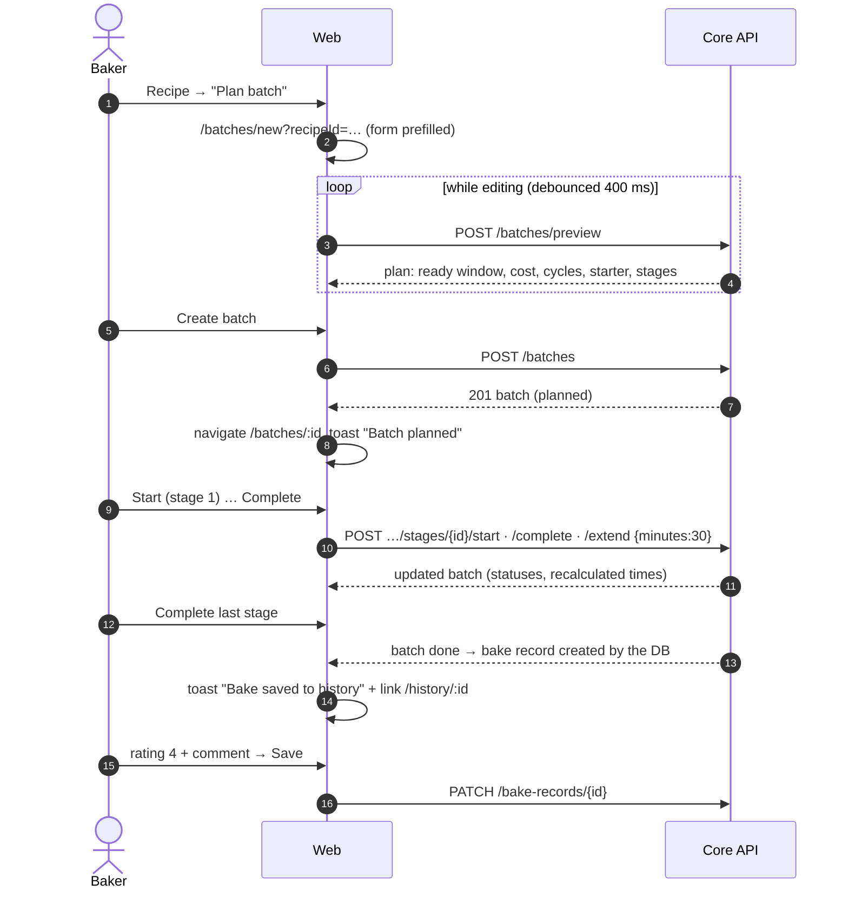
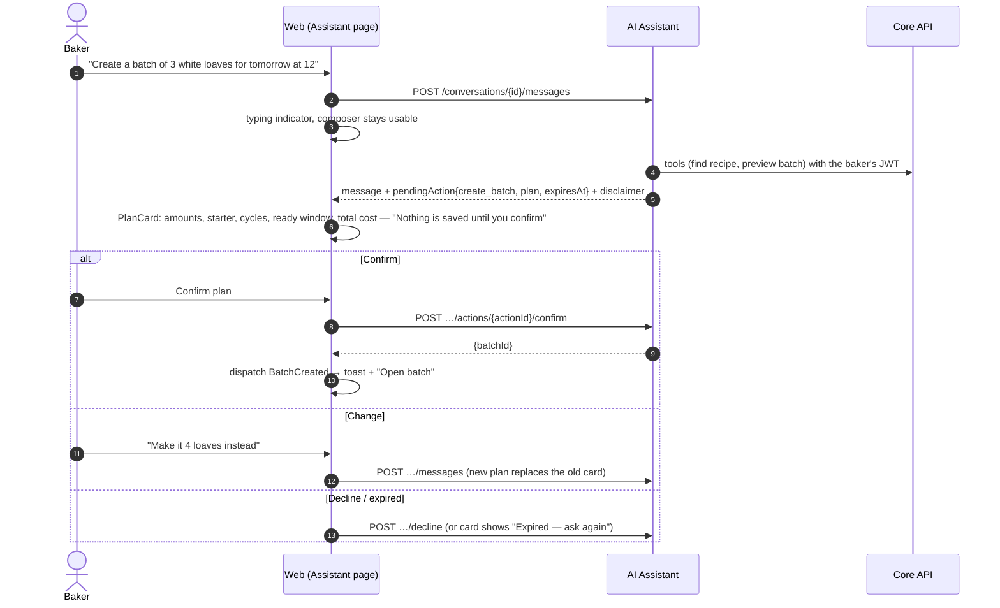
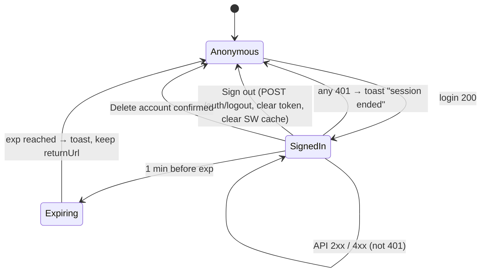

# User flows and navigation

## 1. Navigation map

Back navigation: browser back always works (real routes); detail pages also have a back button in the top bar on
compact. Deep links work after a reload (static host serves `index.html` for unknown paths).

## 2. Flow — sign up and first recipe (US-01, US-05, US-10, US-12, US-13)

Validation errors: client-side (required, ranges, min ≤ max duration) before the request, server `errors` mapped to the
same fields after it.

## 3. Flow — plan and bake a batch manually (US-20, US-23, US-24, US-31, US-32)

Errors on the way: 409 "stage already running" → reload batch; 422 "oven capacity not set" → alert with link to kitchen.

## 4. Flow — batch through the assistant (UC-01: US-34, US-35)

Alternatives: recipe not found → assistant lists similar recipes (rendered as text); 503 → alert + "Use the manual form"
(`/batches/new`); 429 → "limit reached" with the reset time from `usage/me`.

## 5. Flow — analyse a bake (UC-02: US-36)

`/history/:id` → "Ask the assistant" → `POST /assistant/api/v1/bake-records/{id}/analysis` → analysis panel with
"Informational only — based on your stage log and comment". 422 (no feedback yet) → focus the comment field with the
message "Add a comment about the result first". 503 → record unchanged, retry later.

## 6. Flow — starter feeding (US-27, US-28, US-29, US-30)

`/starters` → card "Log feeding" → sheet (compact) / dialog (medium+) with flour, water, kept, temperature, fed at (now)
→ `POST /starters/{id}/feedings` → card shows next feeding and expected peak; reminder is created by the backend.
Push permission is requested in Settings → Reminders, never automatically.

## 7. Flow — public library (US-39–US-42, LR-11)

Visitor: `/library` (search) → `/library/:id` → actions show "Sign in to copy, react and comment" → `/login?returnUrl=…`.
Baker: react (toggle), comment, **Copy to my recipes** → navigate to the new `/recipes/:id`; **Report** → dialog with a
reason. Owner on their publication: **Unpublish**. Admin: `/admin/reports` → open report → Resolve (keep) or Remove
publication.

## 8. Flow — session and errors

